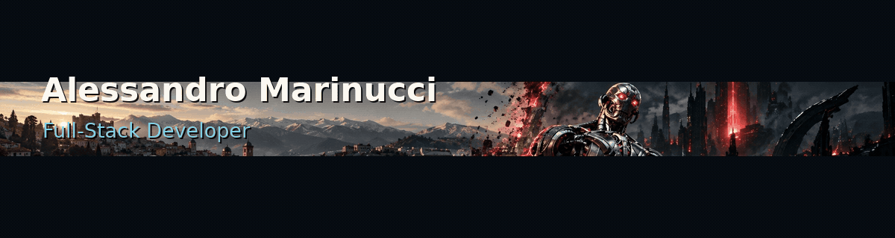

<picture>
  <source
    media="(prefers-reduced-motion: reduce)"
    srcset="./assets/banner/alex-banner-static.png"
  />
  
</picture>

  Computer Science student at the <strong>University of L'Aquila</strong>, focused on web and mobile application development. 
  I build software with an emphasis on clear architecture, maintainable code, and practical user experience.

<a href="https://github.com/AlexMarinucci99">GitHub</a> ·
<a href="mailto:marinucialessandro99@gmail.com">Email</a>

---

## Tech Stack

| Area | Technologies |
| --- | --- |
| **Languages** | Java · Kotlin · Dart · PHP · JavaScript · SQL |
| **Mobile & Web** | Flutter · Jetpack Compose · HTML · CSS |
| **Data & Services** | Firebase · MySQL |
| **Tools** | Git · GitHub Actions |

---

## Featured Project

### [JiVaio](https://github.com/AlexMarinucci99/JiVaio)

  

**A mobile application for navigating public transport in L'Aquila.**

Built with Flutter, JiVaio brings together interactive maps, geolocation, Firebase authentication, and GTFS-derived transit data to make local transport information easier to access.

**Stack:** Flutter · Dart · Firebase · MVVM · GitHub Actions

[View repository](https://github.com/AlexMarinucci99/JiVaio) · [CI workflow](https://github.com/AlexMarinucci99/JiVaio/actions/workflows/flutter-ci.yml)

---

## Selected Projects

- **[MeteoRadar](https://github.com/AlexMarinucci99/AppMeteoRadar)** — Native Android weather application developed with Kotlin and Jetpack Compose, featuring Google Maps integration.
- **[MasterRent](https://github.com/AlexMarinucci99/MasterRent)** — Web platform for university housing management, built with PHP and MySQL.
- **[SafeDriveMonitor](https://github.com/AlexMarinucci99/SafeDriveMonitor)** — JavaFX desktop application for driving safety assessments and management.

*Additional projects are not publicly available due to confidentiality, privacy, or intellectual property requirements.*

---

<!-- CONTRIBUTION ANIMATION -->

## GitHub Contributions

Development activity and contributions across my repositories.

<picture>
  <source
    media="(prefers-color-scheme: dark) and (prefers-reduced-motion: reduce)"
    srcset="https://raw.githubusercontent.com/AlexMarinucci99/AlexMarinucci99/output/github-contribution-grid-starship-dark-static.svg"
  />
  <source
    media="(prefers-reduced-motion: reduce)"
    srcset="https://raw.githubusercontent.com/AlexMarinucci99/AlexMarinucci99/output/github-contribution-grid-starship-light-static.svg"
  />
  <source
    media="(prefers-color-scheme: dark)"
    srcset="https://raw.githubusercontent.com/AlexMarinucci99/AlexMarinucci99/output/github-contribution-grid-starship-dark.svg"
  />
  
</picture>

<!-- END CONTRIBUTION ANIMATION -->
